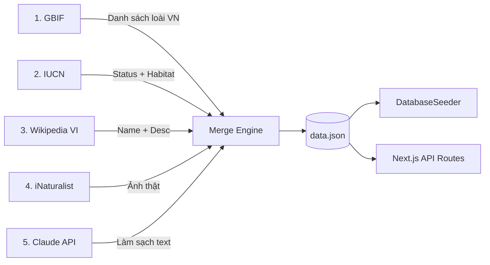
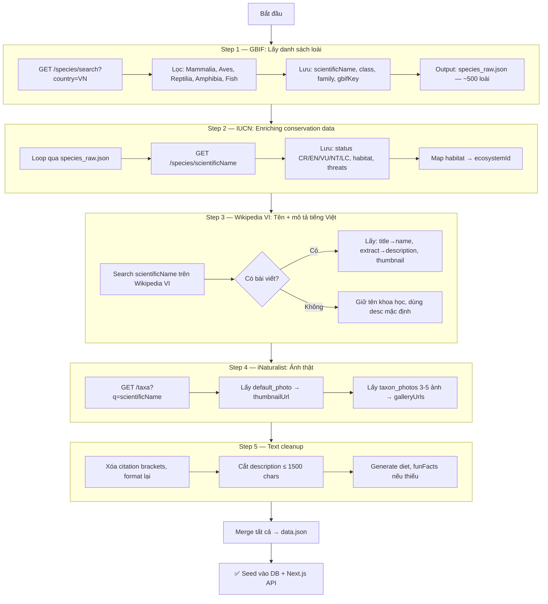

# 🕷️ WildVN Data Crawling Pipeline — Implementation Plan

## Tổng quan kiến trúc



---

## Đánh giá ý tưởng

> [!TIP]
> Ý tưởng **rất tốt**, đúng chuẩn data pipeline chuyên nghiệp. Mỗi nguồn đóng đúng vai trò riêng, không trùng lặp.

| Nguồn | Vai trò | API Key? | Rate Limit | Đánh giá |
|---|---|---|---|---|
| GBIF | Danh sách + phân loại | ❌ Free | 3 req/s | ✅ Tuyệt vời — backbone data |
| IUCN | Conservation status | ⚠️ Cần token (free) | 10 req/s | ✅ Chính xác nhất cho status |
| Wikipedia VI | Tên VN + mô tả | ❌ Free | 200 req/s | ✅ Mô tả tiếng Việt tốt nhất |
| iNaturalist | Ảnh thật CC-licensed | ❌ Free | 1 req/s | ✅ Ảnh chất lượng cao, đúng license |
| Claude API | Làm sạch + dịch | ⚠️ Trả phí | N/A | ⚠️ Xem phân tích bên dưới |

---

## Phân tích chi tiết từng nguồn

### 1. GBIF — Backbone (Danh sách loài)

**Endpoint:** `https://api.gbif.org/v1/species/search`

```python
# Lấy tất cả loài động vật ghi nhận tại Việt Nam
GET /v1/species/search?
    country=VN           # Việt Nam
    &kingdom=Animalia    # Chỉ động vật
    &status=ACCEPTED     # Chỉ tên chính thức
    &rank=SPECIES        # Chỉ cấp loài (không lấy genus/family)
    &limit=300           # Tăng dần
    &offset=0            # Phân trang
```

**Trả về:**
```json
{
  "scientificName": "Pseudoryx nghetinhensis",
  "canonicalName": "Pseudoryx nghetinhensis",
  "vernacularName": "Saola",          // Tên tiếng Anh
  "class": "Mammalia",                // → map sang "Thú"
  "order": "Artiodactyla",
  "family": "Bovidae",
  "kingdom": "Animalia",
  "key": 2441035                      // GBIF taxon key → dùng cho bước sau
}
```

**Map `class` → `category`:**
```python
CLASS_MAP = {
    "Mammalia":    "Thú",
    "Aves":        "Chim",
    "Reptilia":    "Bò sát",
    "Amphibia":    "Lưỡng cư",
    "Actinopterygii": "Cá",
    "Chondrichthyes": "Cá",        # Cá sụn (cá mập, cá đuối)
}
```

> [!IMPORTANT]
> GBIF có **~15,000+ loài động vật** ở VN. Bạn nên lọc theo các tiêu chí:
> - Chỉ lấy loài có ảnh (mediaType=StillImage)
> - Ưu tiên loài có tên Wikipedia VI
> - Ưu tiên loài nguy cấp (CR, EN, VU)
> - Target ban đầu: **200-500 loài tiêu biểu**

---

### 2. IUCN Red List API — Conservation Status

**Đăng ký:** https://apiv3.iucnredlist.org/api/v3/token (miễn phí, cần email)

**Endpoint:**
```python
GET /api/v3/species/{scientific_name}?token={TOKEN}

# Ví dụ:
GET /api/v3/species/Pseudoryx%20nghetinhensis?token=abc123
```

**Trả về:**
```json
{
  "category": "CR",                    // → "Cực kỳ nguy cấp (CR)"
  "population_trend": "Decreasing",
  "habitat": "Forest - Subtropical/Tropical Moist",  // → map sang ecosystem
  "threats": [
    { "title": "Hunting & trapping" },
    { "title": "Logging & wood harvesting" }
  ]
}
```

**Map IUCN habitat → WildVN ecosystem:**
```python
HABITAT_MAP = {
    "Forest":       "Rừng Mưa Nhiệt Đới",
    "Wetlands":     "Rừng Ngập Mặn",
    "Grassland":    "Thảo Nguyên Khô",
    "Shrubland":    "Thảo Nguyên Khô",
    "Marine":       "Biển và Đảo",
    "Rocky":        "Vùng Núi Cao",
    "Artificial":   "Rừng Mưa Nhiệt Đới",  # fallback
}
```

> [!NOTE]
> IUCN API **miễn phí** nhưng cần đăng ký token. Chờ ~1-2 ngày duyệt email.

---

### 3. Wikipedia VI — Tên tiếng Việt + Mô tả

**Endpoint:** `https://vi.wikipedia.org/api/rest_v1/page/summary/{title}`

**Chiến lược tìm tên bài viết:**
```python
# Bước 1: Thử tìm bằng tên khoa học trên Wikipedia VI
GET /w/api.php?action=query&titles={scientific_name}&redirects=1&format=json

# Bước 2: Nếu không có, thử search
GET /w/api.php?action=opensearch&search={scientific_name}&limit=3&format=json

# Bước 3: Lấy summary
GET /api/rest_v1/page/summary/{page_title}
```

**Trả về:**
```json
{
  "title": "Sao la",                   // → name (tiếng Việt)
  "extract": "Sao la hay còn được...", // → description
  "thumbnail": {
    "source": "https://upload.wikimedia.org/...",  // → thumbnailUrl backup
    "width": 330
  }
}
```

> [!WARNING]
> Wikipedia VI **rate limit 200 req/s** nhưng thực tế nên giới hạn **1-2 req/s** để tránh bị block (HTTP 429).

---

### 4. iNaturalist — Ảnh thật (CC Licensed)

**Endpoint:** `https://api.inaturalist.org/v1/taxa`

```python
# Tìm taxon bằng tên khoa học
GET /v1/taxa?q={scientific_name}&is_active=true&per_page=1

# Response chứa ảnh
{
  "results": [{
    "default_photo": {
      "medium_url": "https://inaturalist-open-data.s3.amazonaws.com/...",
      "attribution": "© user, CC BY-NC"
    },
    "taxon_photos": [
      { "photo": { "medium_url": "...", "large_url": "..." } },
      { "photo": { "medium_url": "...", "large_url": "..." } },
      // → galleryUrls (lấy 3-5 ảnh)
    ]
  }]
}
```

**Ưu điểm so với GBIF images:**
- Chất lượng cao hơn (curated)
- Có nhiều ảnh → gallery
- License rõ ràng (CC BY-NC)

> [!CAUTION]
> iNaturalist rate limit **1 request/giây** — rất nghiêm ngặt. Cần `time.sleep(1.2)` giữa mỗi request.

---

### 5. Claude API — Làm sạch text

**Về vấn đề trả phí:**

Claude Sonnet rẻ nhất: **$3/1M input tokens, $15/1M output tokens**

Ước tính cho 500 loài:
```
Input:  500 loài × 1000 chars = 500K chars ≈ 125K tokens → $0.38
Output: 500 loài × 500 chars  = 250K chars ≈ 62K tokens  → $0.93
─────────────────────────────────────────────────────────────
Tổng: ~$1.3 (khoảng 33,000 VND) cho 500 loài
```

> [!TIP]
> **Rẻ hơn ly trà sữa!** Nhưng nếu không muốn tốn tiền, có 2 phương án thay thế miễn phí:

**Phương án thay thế miễn phí:**

| Phương án | Cách làm | Chất lượng |
|---|---|---|
| **A. Python regex** | Tự viết rule xóa ngoặc vuông, ref, format lại | 70% — đủ dùng |
| **B. Ollama local** | Chạy Llama 3.1 8B trên máy | 85% — gần như Claude |
| **C. Google AI Studio** | Gemini API free tier (15 req/phút) | 90% — rất tốt |

---

## Pipeline Flow chi tiết



---

## Cấu trúc file đề xuất

```
wildvn-server/scripts/
├── crawl/
│   ├── step1_gbif.py           # Lấy danh sách loài
│   ├── step2_iucn.py           # Enriching IUCN status
│   ├── step3_wikipedia.py      # Tên VN + mô tả
│   ├── step4_inaturalist.py    # Ảnh thật
│   ├── step5_cleanup.py        # Làm sạch text
│   ├── merge.py                # Gộp tất cả → data.json
│   └── config.py               # API keys, constants
├── data/
│   ├── step1_gbif_raw.json     # Output step 1
│   ├── step2_iucn_enriched.json
│   ├── step3_wiki_enriched.json
│   ├── step4_photos_enriched.json
│   └── final_data.json         # → copy vào data.json
└── run_pipeline.sh             # Chạy tuần tự tất cả
```

---

## Ước tính thời gian chạy

| Step | Số request | Rate limit | Thời gian ước tính |
|---|---|---|---|
| 1. GBIF | ~20 pages | 3 req/s | **~10 giây** |
| 2. IUCN | 500 loài | 10 req/s | **~1 phút** |
| 3. Wikipedia | 500 loài | 1 req/s | **~10 phút** |
| 4. iNaturalist | 500 loài | 1 req/s | **~10 phút** |
| 5. Cleanup | Local | N/A | **~5 giây** |
| **Tổng** | | | **~22 phút cho 500 loài** |

---

## Thứ tự triển khai

### Phase 1 — Chạy được ngay (hôm nay)
- [ ] Viết `step1_gbif.py` → lấy 500 loài từ GBIF
- [ ] Viết `step3_wikipedia.py` → lấy tên VN + mô tả
- [ ] Viết `step4_inaturalist.py` → lấy ảnh
- [ ] Viết `merge.py` → gộp lại

### Phase 2 — Cần đăng ký (1-2 ngày)
- [ ] Đăng ký IUCN API token (miễn phí)
- [ ] Viết `step2_iucn.py`

### Phase 3 — Tùy chọn
- [ ] Claude API hoặc Ollama cho text cleanup
- [ ] Viết `step5_cleanup.py`

---

## Lưu ý quan trọng

> [!IMPORTANT]
> **Rate limiting strategy:** Mỗi step lưu output riêng (`.json`). Nếu bị lỗi giữa chừng, chạy lại từ step đó — không mất data các step trước.

> [!WARNING]
> **License ảnh:** iNaturalist ảnh là CC BY-NC. Nếu WildVN là educational/non-profit thì OK. Nếu commercial, cần dùng ảnh CC BY hoặc CC0 (filter qua GBIF thay vì iNaturalist).
