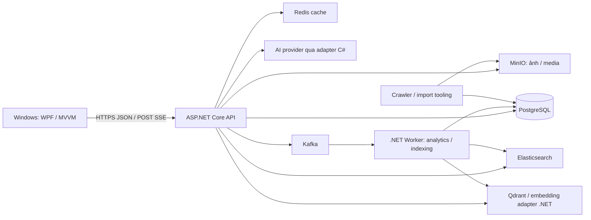

# Kế hoạch chuyển WildVN sang desktop và backend .NET

Ngày khảo sát: **09/10/2026**. Phạm vi đã được người dùng xác nhận: **chỉ Windows; chuyển cả desktop và backend sang .NET**.

Đề xuất: **WPF trên .NET 10 LTS + ASP.NET Core 10**, bảo toàn PostgreSQL, MinIO và dữ liệu hiện có. Thay từng module Spring bằng C#, kiểm tra tương đương API rồi chuyển lưu lượng. Desktop cuối cùng không cần Next.js hoặc Java chạy trên máy người dùng.

Đây là kế hoạch dựa trên mã nguồn và cấu hình trong workspace, chưa phải kết quả kiểm thử runtime. Chưa truy vấn database, kiểm tra dịch vụ đang chạy, đo hiệu năng hoặc chạy build. Backlog triển khai nằm ở [todo.md](todo.md); các đường dẫn `wildvn-dotnet/` bên dưới là cấu trúc dự kiến, chưa được tạo.

## 1. Hiện trạng đã đọc

| Thành phần | Bằng chứng trong repository | Ý nghĩa khi chuyển đổi |
|---|---|---|
| Web | `wildvn-client/package.json`: Next.js 16.3.3, React 19.2.4, TypeScript, Zustand, GSAP, Framer Motion, Tailwind | React/Next và các hiệu ứng DOM phải viết lại; có thể tái dùng nội dung, asset và quy tắc nghiệp vụ |
| Backend | `wildvn-server/build.gradle`: Java 21, Spring Boot 4.0.6, JPA, Flyway, Security/OAuth2 | Backend hiện là **Java**, không phải Kotlin; chuyển controller/service/repository sang C# |
| API client | `wildvn-client/app/_shared/services/api.ts:1`: gọi HTTP tới Spring, không dựa vào Next API runtime | Có ranh giới rõ để thay backend và frontend độc lập |
| Auth | `domain/auth/controller/AuthController.java:32`, `security/JwtAuthFilter.java:34` dưới server | JWT trong cookie `wildvn-auth-token`; login/register trả user, desktop không thể chỉ đọc token từ JSON |
| Nội dung | Domain `species`, `taxonomy`, `ecosystem`, `media`, `favorite`, `academy` dưới server | Giữ UUID/slug/quan hệ hiện tại, không nhập lại dữ liệu thành database mới |
| Chat | `domain/chat/ChatController.java:40` | HTTP **POST SSE**, event `token`/`done`; hiện nhận toàn bộ câu trả lời rồi chia chunk, chưa phải token stream trực tiếp từ model |
| Search | Domain `search` và `docker-compose.yml` | Có mã Elasticsearch, Redis, Kafka, Qdrant và ML adapters; cần xác minh mức vận hành thực tế |
| Thu thập dữ liệu | `crawl4ai-project/`, `scripts/`, server `scripts/seed_crawler.py` | Là công cụ crawler/import; có thể giữ ngoài runtime ứng dụng .NET |
| Kiểm thử | Client `scripts/*.test.ts`, server `src/test/java/`, hai Jenkinsfile | Có nền tảng test; chưa có số đo coverage xác minh được từ lượt khảo sát |

### Phân biệt chức năng thật với thiết kế/placeholder

| Nhóm | Hiện trạng | Phạm vi bản desktop đầu tiên |
|---|---|---|
| Trang chủ, search, danh sách/chi tiết loài, hệ sinh thái | Có UI/API thật; home thiên về trải nghiệm video/hiệu ứng | Giữ nội dung và các luồng tra cứu, thiết kế lại điều hướng desktop |
| Đăng ký, đăng nhập, đăng xuất, thông tin user | Có API cookie auth | Chuyển đầy đủ, giữ tài khoản và hash mật khẩu |
| Google/Facebook | Có entry OAuth và callback backend; phụ thuộc cấu hình provider | Giữ các provider được cấu hình và kiểm thử được, đổi luồng quay về desktop |
| Profile/favorites | `/profile` chuyển tới favorites; favorites có API | Làm favorites và thông tin user cần thiết; không coi profile editor là tính năng đã có |
| Academy, field notes, arena | Dùng catalog/progress thật; arena là flashcard dựa trên loài | Giữ overview, sổ loài, flashcard và sync progress |
| Expedition | `app/academy/expeditions/[slug]/page.tsx` thông báo chưa có module | Giữ trạng thái chưa có nội dung hoặc ẩn entry; hoàn thiện expedition là tính năng mới |
| Quên/đặt lại mật khẩu | Hai page chỉ đợi `setTimeout`, không gọi API | Không hiển thị thông báo gửi email/đổi mật khẩu thành công giả; đưa API reset/email vào backlog mở rộng |
| Camera nhận diện, bản đồ, quiz đầy đủ, badge/XP phức tạp | Có thiết kế/nội dung quảng bá; chưa thấy luồng runtime hoàn chỉnh tương ứng | Không tính là chức năng đã triển khai cần chuyển |
| Voice input | `AIChatInput.tsx` dùng Web Speech API, tiếng Việt | Cần thử engine Windows; nếu chưa đạt, hiển thị rõ trạng thái không khả dụng và cho nhập chữ |

Tài liệu `planning.md` nêu snapshot 1.176 loài. Đây là số liệu tài liệu, **chưa được xác minh trên DB hiện tại**; số lượng/ID/media dùng cho nghiệm thu phải lấy từ bản backup thực tế tại T02.

Trong workspace có file JSON OAuth credentials tại root. Chưa xác minh file có được Git theo dõi, từng chia sẻ hoặc credential còn hiệu lực: `git status` không đọc được repository metadata ở môi trường khảo sát. T01 cần kiểm tra tracking/ignore/lịch sử và đường đóng gói; nếu xác nhận đã lộ thì đổi credential qua provider trước khi dùng OAuth môi trường thật. Không đưa nội dung credential vào contract fixtures, tài liệu hoặc installer.

## 2. Lựa chọn công nghệ

| Lớp | Chọn | Lý do và giới hạn |
|---|---|---|
| Runtime | .NET 10 LTS, khóa SDK và cập nhật patch còn hỗ trợ | Theo Microsoft, .NET 10 được hỗ trợ đến 14/11/2028; .NET 8/9 hết hỗ trợ 10/11/2026 nên không hợp làm đích migration mới vào thời điểm khảo sát |
| Windows UI | WPF + XAML + MVVM | Phù hợp phạm vi chỉ Windows; dùng `CommunityToolkit.Mvvm` để giảm code liên kết UI/state |
| Backend | ASP.NET Core 10 Web API, tổ chức theo domain | Chuyển toàn bộ endpoint/service/jobs do Spring sở hữu sang .NET |
| Dữ liệu | EF Core + Npgsql, SQL tường minh cho chỗ đặc thù | Map vào PostgreSQL hiện có; khóa bộ phiên bản tương thích .NET 10/EF Core thay vì tự nâng mọi package |
| HTTP desktop | `HttpClient`, DTO dùng chung, `CookieContainer`, cancellation | Giữ hợp đồng cookie/XSRF giai đoạn đầu; không giả định backend hiện hỗ trợ bearer header |
| Media | Image/media services WPF; WebView2 chỉ cho nội dung cục bộ đã chứng minh cần thiết | T05 quyết định codec, cách đọc nội dung và chi phí giữ hiệu ứng; không tải nguyên Next website làm ứng dụng cuối cùng |
| Kiểm thử | xUnit, PostgreSQL fixtures, kiểm thử API, Windows UI Automation | Unit/integration/E2E theo từng chức năng; coverage production C# tối thiểu 80% |
| Triển khai | Backend container .NET; desktop installer Windows có ký số | Backend vẫn có thể chạy Linux như môi trường hạ tầng hiện tại; Windows là yêu cầu của desktop |

Nguồn chính thức: [.NET support policy](https://dotnet.microsoft.com/en-us/platform/support/policy/dotnet-core), [WPF overview](https://learn.microsoft.com/en-us/dotnet/desktop/wpf/overview/), [MVVM Toolkit](https://learn.microsoft.com/en-us/dotnet/communitytoolkit/mvvm/), [Npgsql enum mapping](https://www.npgsql.org/efcore/mapping/enum.html).

WPF native là đích mặc định. Trong T05, làm một màn chi tiết với ảnh/video/audio và một mẫu trang chủ để đo khả năng giữ trải nghiệm. Nếu yêu cầu hiệu ứng cinematic tương đương web làm WPF quá tốn công, dùng WebView2 giới hạn ở vùng trình bày asset cục bộ, có bridge nhỏ và kiểm tra nguồn/message. [Microsoft hướng dẫn bảo mật WebView2](https://learn.microsoft.com/en-us/microsoft-edge/webview2/concepts/security).

WPF + Blazor Hybrid là phương án dự phòng nếu cần nhiều HTML/CSS và muốn viết UI bằng C#/Razor. React component **không** tự chuyển thành Razor; phương án này vẫn cần viết lại UI và kiểm thử JS interop. [Microsoft Blazor Hybrid](https://learn.microsoft.com/en-us/aspnet/core/blazor/hybrid/?view=aspnetcore-10.0). Không cần MAUI/Avalonia cho phạm vi Windows đã chốt.

## 3. Kiến trúc đích



Desktop chỉ nói chuyện với API và URL media được phép; credential PostgreSQL/MinIO/AI/OAuth secret thuộc server. Desktop không truy cập trực tiếp PostgreSQL và không mang hạ tầng Kafka/Elasticsearch lên từng máy Windows. “Toàn bộ backend .NET” ở đây là code API, nghiệp vụ và worker của WildVN; PostgreSQL, MinIO, Elasticsearch, Kafka vẫn là sản phẩm hạ tầng, có runtime riêng.

```text
wildvn-dotnet/                         # thư mục mới, tạo khi triển khai
  WildVN.sln
  src/
    WildVN.Desktop/                    # WPF Views, ViewModels, navigation, Windows services
    WildVN.ApiClient/                  # typed HTTP, cookie/XSRF, SSE parser
    WildVN.Contracts/                  # DTO/enum JSON dùng chung, không có EF entity
    WildVN.Api/                        # HTTP endpoints, auth, DI, health, config
    WildVN.Application/                # use cases theo Species/Auth/Academy/Chat/Search
    WildVN.Infrastructure/             # EF mappings, repositories, MinIO/AI/search adapters
    WildVN.Worker/                     # consumer/jobs tách khỏi HTTP process
  tests/                              # unit, API integration, Windows E2E
  deploy/                             # container, routing, installer, migration scripts
```

Các project được tạo dần khi có code sử dụng; không dựng thêm CQRS/mediator/microservice cho mọi thao tác. DTO và state nghiệp vụ dùng bản sao/record bất biến; UI binding và EF tracking được giữ ở lớp adapter cần thiết, không để chúng trở thành state nghiệp vụ dùng chung.

## 4. Những phần cần chuyển đúng hành vi

### 4.1 Database và schema ownership

- Lấy schema/extension/index/trigger/view/constraint thực tế, Flyway history và backup; diễn tập restore trước khi dùng làm dữ liệu nghiệm thu.
- `db/design/*` và `db/sql/*` là tài liệu/DDL thiết kế, khác runtime `beforeMigrate.sql`, V0–V4 và `afterMigrate.sql`. Đặc biệt `db/sql/01_extensions_enums.sql` có `DROP TYPE ... CASCADE`; không chạy lại bộ SQL thiết kế lên DB thật để tạo đích .NET.
- Map chính xác enum tên có dấu ngoặc kép như `"DietType"`, enum arrays `"HabitatType"[]`, `TEXT[]`, JSONB, UUID, TIMESTAMPTZ, soft delete và khóa ghép. Scaffolding không đảm bảo tự map đầy đủ PostgreSQL enum, theo [Npgsql](https://www.npgsql.org/efcore/mapping/enum.html).
- `users.id` là UUID, nhưng `user_favorites.user_id` và `academy_progress.user_id` hiện là string gắn với username trong service. Không tự đổi mọi user key thành UUID hoặc email trong lần port đầu.
- Trong thời gian cùng tồn tại, **chỉ một pipeline Flyway sở hữu DDL**; EF dùng existing schema, không `EnsureCreated`, không tự `Database.Migrate` khi API khởi động. Tách quyền migrate khỏi quyền runtime.
- Sau cutover, giữ một bộ SQL migration do pipeline .NET chạy; lựa chọn EF migrations chỉ sau khi có baseline đã kiểm thử cho cả DB hiện hữu và DB rỗng. Giữ lịch sử Flyway; không chạy initial CREATE TABLE lên DB đã có dữ liệu.
- Không thay model embedding/dimension, collection/index hoặc storage engine cùng lúc chuyển framework.
- Khi ngừng Next client, sửa pipeline crawler/import đang gọi `wildvn-client/seed_test.ts` qua absolute path Linux (`crawl4ai-project/run_pipeline.sh:19`). Tách importer thành CLI/tooling độc lập; crawler vẫn chạy được mà không phải khởi động Next server hoặc Spring.

### 4.2 Auth và phiên desktop

- Tái dùng user/account hiện có. Xác minh C# đọc hash Argon2id do Spring tạo bằng test vectors cùng tham số/encoding; không dùng mặc định ASP.NET Identity rồi bắt người dùng reset mật khẩu. Việc rehash về sau chỉ làm khi login thành công và có chính sách riêng.
- Giữ tên cookie và contract auth hiện tại trong giai đoạn tương thích; `HttpClient` có cookie jar, lấy token XSRF cho mutation. Có test khởi tạo CSRF token, 401/403, logout và hết hạn phiên.
- ASP.NET `AddCookie` không tự đọc được JWT của Spring: cần handler xác minh JWT đọc từ cookie. Kiểm thử algorithm thực tế, Base64 key, `sub` username và thời hạn; nếu thay issuer/audience hoặc định dạng phiên, version hóa và chốt thời điểm yêu cầu login lại.
- C# và Java cùng tồn tại chỉ chia sẻ key trong secret store phía server khi cần interoperability; không copy signing key vào desktop. Rút cửa sổ nhận legacy token sau khi chuyển xong.
- Session giữ trong bộ nhớ mặc định. Nếu có tùy chọn nhớ đăng nhập, mã hóa bằng Windows DPAPI/credential store theo user; không lưu cookie/token trong JSON thường hoặc log. User hiển thị đã cache không chứng minh còn đăng nhập.
- Social login mở **trình duyệt hệ thống**. Backend .NET xử lý provider callback, trả mã một lần về loopback callback của app; app đổi mã qua HTTPS để nhận phiên. Broker cần `state`, PKCE cho leg desktop, callback allowlist, TTL ngắn và chống replay. Không chuyển access token qua query string hay nhúng OAuth client secret vào app.
- Thiết lập Secure/SameSite/domain cho deployment thật và CSRF cho luồng cookie dùng bởi web/WebView; không sao chép `secure(false)` từ OAuth handler Java. Desktop native không cần CORS, còn web/WebView có origin thì phải cấu hình rõ.

### 4.3 API và UI theo từng luồng

| Luồng | Contract cần giữ | Chuyển desktop |
|---|---|---|
| Auth | `/api/auth/login`, `/register`, `/me`, `/logout`; body `{user}` và logout có thể không có body | Login/register, trạng thái session, đăng xuất và lỗi mạng |
| Catalog | `/api/species`, `/featured`, `/facets`; page bắt đầu từ 1, filter theo dữ liệu | Danh sách có virtualization, tìm kiếm debounce, phân trang, lọc ở server |
| Detail/media | `/api/species/{slug}`, `/{slug}/related`, media public/presigned | Nội dung đọc, taxonomy, bảo tồn, gallery/video/audio, liên kết loài liên quan |
| Ecosystems | `/api/ecosystems`, `/{slug}` | Danh sách/chi tiết, không dựa vào Next redirect |
| Favorites | GET list/status và POST toggle | Toggle có khóa thao tác khi request đang chạy; không tự retry POST vì có thể đảo trạng thái hai lần |
| Academy | `/api/academy/overview`, GET/POST `/sync` | Overview/field notes/flashcard; giữ RP/streak từ server, không chấp nhận số điểm client tự gửi |
| Chat | `/api/chat`, POST `/stream`, sessions/messages/delete | Panel chat, ngữ cảnh entity thay pathname, citations điều hướng bằng slug |
| Search mở rộng | `/api/search/*`, `/api/recommend/*`, `/api/admin/sync/*` | Chuyển API/worker có trong code; bật UI theo năng lực dịch vụ đã kiểm chứng |

Giữ envelope `success`, `message`, `data`, `pagination`/`meta` khi endpoint có sử dụng. **Không ép** auth, logout, lỗi hoặc SSE vào cùng một parser. Định nghĩa contract riêng cho status/error/content type/null/date/enum. Nếu muốn chuẩn hóa về sau, làm API version mới sau giai đoạn parity.

Ghi quy tắc visibility theo từng endpoint: species catalog/detail/featured/related hiện lọc soft delete nhưng không bắt buộc `PUBLISHED`; Academy sync chỉ nhận loài `PUBLISHED`; ecosystem model hiện không có publish/soft-delete fields tương ứng, và danh sách loài trong ecosystem detail hiện query `findByEcosystemId` không có bộ lọc đó. Fixtures cần có cả draft/deleted/published khi model hỗ trợ để mô tả đúng hành vi, không gắn một bộ lọc chung lên toàn API rồi gọi đó là parity. Nếu phát hiện dữ liệu riêng tư bị trả ra, tách correction có tiêu chí bảo mật rõ và kiểm tra tác động, không duy trì lỗi chỉ để kết quả giống hệ cũ.

Academy hiện từ chối `completedExpeditions` mới khi chưa có catalog; không tái tạo progress/quiz demo để làm UI trông đầy đủ. Local state mới phải chia theo user; không tự nhập token/cookie từ browser profile. Với tiến trình cũ chỉ ở localStorage, cân nhắc exporter JSON theo user nếu thực tế có dữ liệu cần giữ.

### 4.4 Chat, media và search workers

- Duy trì SSE **POST**, event `token`/`done` và DTO citations/provider/sessionId; không thêm SignalR chỉ vì đây là desktop. Parser phải chịu UTF-8 chia giữa chunk, nhiều event/chunk, CRLF, hủy và mất kết nối; thao tác UI quay về dispatcher.
- Giữ database provider và Anthropic adapter C#, timeout/fallback, giới hạn input/rate và quyền sở hữu history. Retention mặc định hiện là 5 ngày; kiểm thử bằng clock có thể điều khiển. Streaming model thật là cải tiến riêng, không nhầm là hành vi hiện có.
- Ảnh hiện gồm WebP và URL MinIO; video có MP4/WebM, âm thanh dùng Web Audio ở web. T05 xác nhận codec Windows, presigned URL hết hạn, giảm chuyển động, kích thước cửa sổ/DPI, mute và dọn media khi đổi màn. Không đóng gói toàn bộ video/frame sequence vào installer mà chưa tính kích thước.
- Chuyển search adapters sang C#: Elasticsearch keyword/suggest, Redis TTL/cache key, Qdrant semantic/hybrid, recommendation, event tracking, admin reindex/failures. Phân biệt tìm loài qua `/api/species?q=` đang dùng trong UI với search pipeline nâng cao.
- `MlServiceClient` gọi `/ml/embed` và `/ml/rerank`, nhưng chưa thấy implementation ML server hoặc container tương ứng trong repository. T01 phải xác minh dependency ngoài repo. Nếu đang có backend Python do dự án sở hữu, phải lập slice inference C# tương đương để đạt đích toàn bộ backend .NET; nếu chưa tồn tại, ghi rõ missing capability, không cam kết migration sẽ tự hoàn thiện ML model.
- Giữ topic/event payload/index schema trong lúc port. Shadow consumers dùng group và sink riêng. Khi đổi consumer thật, dừng Java consumer, ghi nhận offsets rồi cho .NET nhận group tương ứng; không để hai hệ cùng xử lý side effect lên production.
- **GET `/api/search` có side effect** `trackSearch`. Không mirror mọi GET sang cả hai backend; parity chạy trên fixture hoặc mode tắt analytics, namespace cache/index riêng. Không shadow các request login/toggle/sync/chat/reindex có ghi dữ liệu.

## 5. Lộ trình và các mốc nghiệm thu

Ước lượng dưới đây giả định **2 lập trình viên biết .NET, QA tham gia đều**, ưu tiên WPF native, backend online, không thêm expedition/reset-email/ML training. Đây là dải lập kế hoạch, cần ước lượng lại sau baseline và PoC.

| Giai đoạn | Tasks | Thời lượng lịch dự kiến | Mốc hoàn thành |
|---|---|---|---|
| P0: Khóa baseline và rủi ro | T01–T05 | 1–2 tuần | Contract inventory; fixture/restore; API/desktop skeleton; chốt media/UI sau PoC |
| P1: Dữ liệu và auth | T06–T10 | 2–3 tuần | C# map DB và verify mật khẩu cũ; Windows login/logout/OAuth chạy từ đầu đến cuối |
| P2: Tra cứu và favorites | T11–T16 | 2–3 tuần | Catalog/filter/detail/media/ecosystems/favorites trên WPF + API .NET |
| P3: Academy và chat | T17–T22 | 2–3 tuần | Field notes/flashcard/progress; chat/citations/history/SSE/fallback |
| P4: Search và vận hành | T23–T27 | 2–3 tuần | Search/worker có dependency được kiểm chứng; voice có trạng thái rõ; CI kiểm tra coverage/parity/E2E |
| P5: Phát hành và thay thế | T28–T30 | 1–2 tuần + thời gian quan sát | Installer Windows; backend .NET; rollback diễn tập; ngừng Next/Spring runtime |

Tổng sơ bộ **10–16 tuần**, dự trù **12–20 tuần** nếu tính biên cho schema/media/OAuth/search. Nếu chỉ một developer kiêm QA hoặc cần hoàn thiện ML/reset-email/expedition, phải tăng và tính lại effort; chưa có cơ sở chốt ngày giao chắc chắn.

Thứ tự có thể song song: sau khi DTO/contract được khóa, một người làm ASP.NET, một người làm WPF dùng stub contract. UI PoC chạy song song baseline DB. Sau auth, các luồng catalog/ecosystem và chat có thể tách ownership. DDL, auth shared contract và consumer cutover phải điều phối tuần tự.

Mỗi task viết test hành vi trước, implementation tối thiểu, rồi review. Chi tiết dependencies, file dự kiến và tiêu chí nghiệm thu xem [todo.md](todo.md). Nếu task thực tế vượt 5 file hoặc không thể kiểm chứng trong một phiên tập trung, tách nhỏ trước khi làm.

## 6. Cách chạy cùng tồn tại và chuyển hệ thống

1. Giữ web/Spring để tham chiếu trong giai đoạn migration; dựng API .NET trên địa chỉ nội bộ riêng với database fixture trước.
2. Parity so sánh Java và .NET trên cùng fixture; chuẩn hóa các field biến động như thời gian/URL hết hạn, nhưng không loại bỏ khác biệt nghiệp vụ/quyền truy cập. Golden sample không chứa credential hoặc dữ liệu cá nhân thật.
3. Khi đưa API mới lên môi trường có dữ liệu thật, gateway/routing quyết định **một backend chủ trì mỗi module**. Kiểm tra cả luồng web hiện tại; không để desktop ghi .NET và web ghi Java cho cùng module vì cấu hình BaseUrl khác nhau.
4. Module read-only chuyển trước. Auth chỉ chuyển sau interoperability hoặc kế hoạch login lại; favorites/academy/chat chỉ chuyển sau transaction/permission/parity test. Index/analytics jobs được chuyển bằng quy trình offsets riêng.
5. Schema trong cửa sổ rollback chỉ thay đổi theo hướng cũ vẫn đọc được. Rollback bằng routing + binary/config trước; restore backup chỉ cho tình huống dữ liệu bị hỏng và có tính đến dữ liệu mới, không khôi phục mù sau mọi lỗi.
6. Bản desktop thử nghiệm với nhóm nhỏ; quan sát lỗi auth, mất media, p95 API, stream timeout, worker lag và báo cáo crash. Ngưỡng định lượng chốt từ baseline P0, không tự đặt giả định thành SLA.
7. Chỉ ngừng Next/Spring sau khi tất cả module bắt buộc đã chuyển, rollback được diễn tập và kết thúc thời gian quan sát đã chốt. Lưu tag/artifact/runbook hệ cũ; không xóa lịch sử DB hoặc asset nguồn.

### Cài đặt Windows

Mặc định installer self-contained `win-x64`; ARM64 là slice bổ sung khi có nhu cầu. Chốt mức Windows hỗ trợ theo [.NET 10 supported OS](https://github.com/dotnet/core/blob/main/release-notes/10.0/supported-os.md), WPF và WebView2 runtime thực tế: ưu tiên Windows 11 còn được hỗ trợ; Windows 10 chỉ đưa vào ma trận nếu edition/lifecycle và runtime phù hợp. Thử trên máy sạch, không dựa vào SDK đã cài ở máy developer.

Chọn một hình thức MSIX hoặc installer truyền thống sau khi kiểm tra yêu cầu quyền cài/cập nhật. Ký artifact, cấu hình HTTPS/API endpoint, phiên bản và update/rollback; chứng thư ký số là dependency triển khai, không đưa vào repository. Nếu T05 chọn WebView2, kiểm tra và phân phối runtime theo [Microsoft WebView2 distribution](https://learn.microsoft.com/en-us/microsoft-edge/webview2/concepts/distribution).

## 7. Kiểm thử và điều kiện hoàn tất

- Unit: pagination/facets, DTO conversion, media resolution, auth/hash vectors, progress validation, citations, SSE parser, retention và view-model state. Đo tối thiểu **80% line và branch coverage trên production C# desktop/API/application/infrastructure/worker** với report tổng hợp; công khai phạm vi công cụ không đo được như XAML, không bỏ business code để tăng số.
- Integration: PostgreSQL tái lập có enum/JSONB/array/UUID/keys thật, auth/cookie/CSRF, 404/filter/pagination, favorites, academy, chat ownership và MinIO adapter. Search/worker dùng fixture và dịch vụ tương ứng khi cần xác minh serialization/query/offset; mock external AI cho deterministic CI.
- E2E trên Windows: cài → login → tìm loài ngoài trang đầu → xem media → favorite → đăng xuất/đăng nhập → progress/flashcard → chat/citation/history. Thử OAuth trong staging provider có cấu hình; test mất mạng, đổi tài khoản, đóng app lúc stream và khởi động lại.
- Backend có thể test trên Linux CI; WPF/UI E2E cần Windows runner có desktop session. Playwright web hiện tại không thay thế được kiểm thử WPF native.
- Jenkins server hiện loại bốn suite phụ thuộc snapshot (`wildvn-server/Jenkinsfile:52`). T02/T27 phải có fixture tái lập và chạy các hành vi tương ứng; không lấy pipeline xanh với suite bị loại làm bằng chứng migration đã đủ parity.
- Kiểm tra dữ liệu trước/sau: row counts theo baseline, UUID/slug/relationships, tài khoản/hash, favorites/progress/chat theo user, media object paths và history migration. Counts không thay thế kiểm tra nội dung/khóa/ownership.
- Nghiệm thu cuối: app Windows và server/workers do dự án sở hữu chạy .NET; không còn process Next.js/Spring trong runtime ứng dụng WildVN; không lộ secret trong installer; tài khoản và dữ liệu được giữ; API/desktop tests, coverage, installer sạch và rollback đạt yêu cầu. Runtime riêng của sản phẩm hạ tầng không thuộc phạm vi viết lại.

## 8. Rủi ro, quyết định còn mở

| Rủi ro đã có căn cứ | Cách xử lý / mốc |
|---|---|
| Runtime schema khác DDL thiết kế; enum/legacy key dễ map sai | Snapshot/restore + mapping tests, một owner DDL, T02/T06 |
| Hash/token/cookie/OAuth không tương thích giữa Java và .NET | Test vectors + cookie interoperability + browser broker PoC, T07–T10 |
| Native UI mất hiệu ứng/codec hiện tại | Chốt mức giữ trải nghiệm qua media PoC trước khi xây nhiều màn, T05 |
| Shadow/cutover gây double analytics, toggle hoặc reindex | Side-effect inventory, single writer, shadow sink riêng, T25/T29 |
| Semantic/ML có client nhưng thiếu server trong repo | Xác minh deployment ngoài repo tại T01; tách capability chưa có khỏi migration parity |
| Có test nhưng baseline/coverage chưa tái lập được | Fixtures + coverage artifacts + Windows E2E, T02/T27 |
| File OAuth credentials nằm trong workspace; trạng thái tracking/chia sẻ chưa xác minh | Kiểm tra ignore/tracking/lịch sử và package, đổi nếu xác nhận đã lộ; T01 trước OAuth deployment |

Những điểm đã chốt: Windows-only; desktop **và** backend .NET; dùng .NET hiện đại thay cho việc chọn .NET Framework 4.x làm đích mới. Những điểm P0 cần chốt bằng evidence: edition Windows tối thiểu, mức giữ cinematic, dependency search/ML thực sự đang hoạt động, nơi host API và phương thức ký/cập nhật installer. Các quyết định này không cản trở việc bắt đầu baseline/contract/PoC.

## 9. Nguồn đọc và mức tin cậy

Nguồn chính trong repo: `wildvn-client/package.json`, `app/_shared/services/api.ts`, `authStore.ts`, `aiChatStore.ts`, `app/academy/*`, auth pages, `wildvn-server/build.gradle`, các domain controller/service/repository, security/OAuth handlers, Flyway callbacks/V0–V4, `wildvn-server/Jenkinsfile` cho backend CI, `wildvn-client/Jenkinsfile` cho frontend CI, `docker-compose.yml`, `db/design/*`, crawler/import scripts và `planning.md`.

Đã đối chiếu inventory frontend/backend/hạ tầng bằng các agent đọc độc lập. Kế hoạch có thể dùng để bắt đầu T01–T05; parity/runtime/coverage là kết quả phải đo trong triển khai, không phải điều đã được chứng minh bởi tài liệu này.
